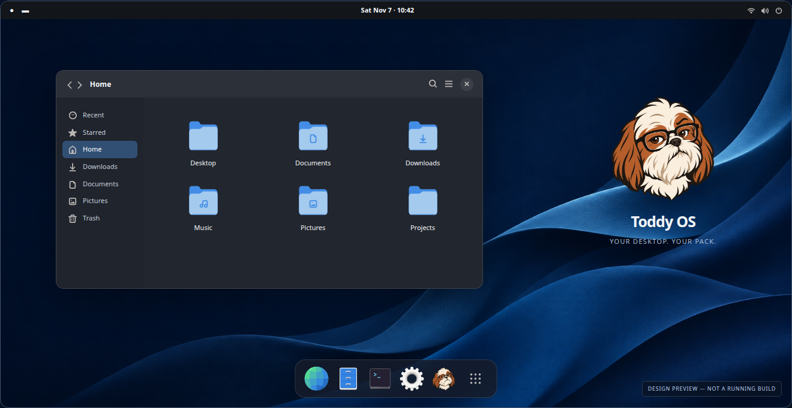
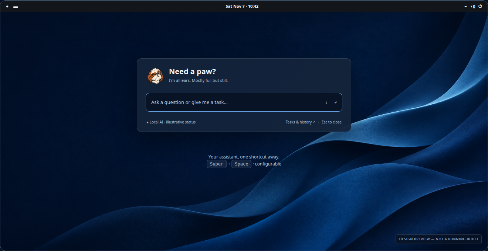

<div align="center">


# Toddy OS

**Linux built from source. A familiar desktop and a personal assistant you can customize are next.**

Experimental preview · Foundation tested in QEMU/KVM · Working toward 1.0

**[Explore the website](https://markaraujo.github.io/toddy-os/)** · **[Download the foundation preview](https://github.com/markaraujo/toddy-os/releases/tag/v0.1.0-foundation.1)**

</div>

Toddy OS is an independent Linux project created by Marcos Araujo and named after
his Shih-tzu, Toddy. The goal is a minimal GNOME desktop with everyday essentials
and an assistant whose personality, tools and model you can choose.

## What you can try today

The current release, **v0.1.0-foundation.1**, provides a command-line live foundation
built with Linux From Scratch and tested in QEMU/KVM. Its live filesystem is
volatile. Start with the [testing guide](docs/FOUNDATION-TESTING.md), and read the
[release notes and checksums](https://github.com/markaraujo/toddy-os/releases/tag/v0.1.0-foundation.1)
before trying the ISO.

Phase 2 plans the GNOME desktop, native Toddy assistant, optional local/API AI and
guided installation. Guest implementation has not started and requires explicit
owner approval after foundation review. Physical hardware validation is pending;
the project remains experimental until a genuine accepted 1.0 release.
[Current status](STATUS.md) records what has actually passed.

The planned offline installation includes the basic desktop and a lightweight
setup entry. Add agent components and choose local/API AI later without
reinstalling. This describes Phase 2, not the current foundation ISO.
The [development handoff](docs/DEVELOPMENT.md),
[implementation plan](docs/PHASE-2-PLAN.md) and
[prepared contracts](docs/PHASE-2-PREWORK.md) are the starting points for contributors.

## A look at the planned desktop

These are **design concepts, not screenshots of a running release**. Click an
image to explore its interactive preview. The downloadable foundation does not
yet include this interface.

[](https://markaraujo.github.io/toddy-os/ui/preview.html#desktop)

*A familiar desktop with a focused selection of everyday apps.*

[](https://markaraujo.github.io/toddy-os/ui/preview.html#quick)

*The planned quick-entry window for asking Toddy a question or giving him a task.*

The [website](https://markaraujo.github.io/toddy-os/) has more previews, wallpapers,
release information and progress in six languages, with browser-language detection
and manual selection. Meet the [project supporters](https://markaraujo.github.io/toddy-os/supporters.html)
or [support development on Patreon](https://www.patreon.com/ToddyOS).

## Follow the work

- [Phase 2 plan](docs/PHASE-2-PLAN.md) and [customizable assistant harness](docs/PHASE-2-HARNESS.md)
- [Focused tests and owner validation](docs/PHASE-2-VALIDATION.md)
- [Development handoff](docs/DEVELOPMENT.md) and [milestone stories](stories/README.md)
- [Releases and the road to 1.0](docs/RELEASES.md)

For contributions, read the [contributor guide](CONTRIBUTING.md). For a suspected
vulnerability, follow the [security reporting policy](SECURITY.md).

Read [AGENTS.md](AGENTS.md) before implementation. Keep deliveries small, preserve
verified checkpoints and record observed results instead of estimating progress.
Repository consistency checks are intentionally separate from OS builds:

```sh
make check
make progress
```

The generated `dashboard/index.html` also opens directly in a browser without a
service or external assets.

<details>
<summary>Build, recovery and design documentation</summary>

- [Product requirements](PRD.md)
- [Build procedure](docs/BUILD.md)
- [Fresh foundation rebuild](docs/FRESH-BUILD.md)
- [Recovery checkpoints](docs/RECOVERY.md)
- [Foundation delivery evidence](docs/evidence/H13.md)
- [Architecture decisions](docs/adr/README.md)
- [Visual identity](assets/brand/README.md)
- [GNOME and Toddy concept sources](ui/preview.html)
- [Installer storytelling preview](https://markaraujo.github.io/toddy-os/ui/installer-slides.html)

</details>

Source archives, model weights, disk images, ISO files, secrets and runtime memory
stay outside Git. Downloadable artifacts are distributed through GitHub Releases.

## Licensing

Original code is [MIT licensed](LICENSE); original documentation and approved
artwork are [CC BY 4.0](LICENSES/CC-BY-4.0.txt). See [LICENSING.md](LICENSING.md)
for scope and attribution. Linux, GNU tools, libraries and other third-party
components keep their own terms. Current brand artwork is PNG, not a vector master.
