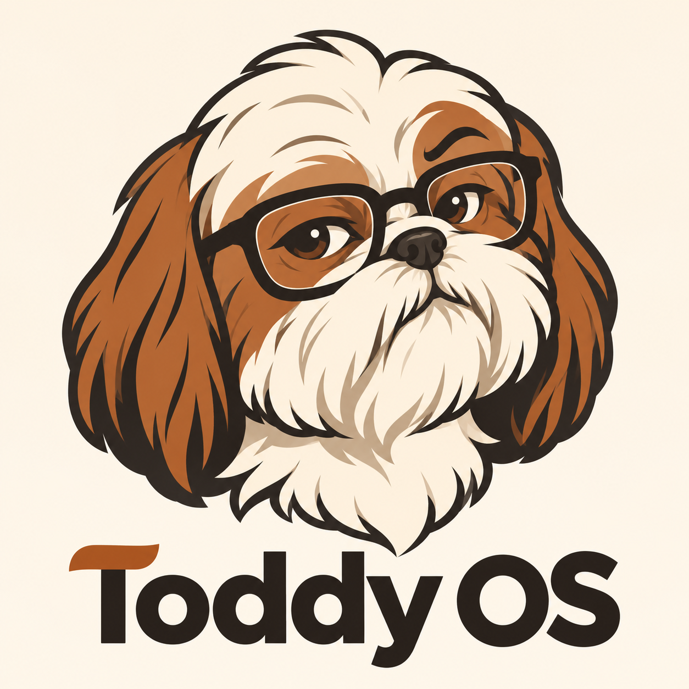

<div align="center">



# Toddy OS

**An independent Linux distribution built from source, with an open agentic desktop for development and automation.**

Foundation G1 passed in QEMU · Awaiting owner testing · Desktop and agent pending

</div>

## Start here

- [Product requirements](PRD.md)
- [Live progress dashboard](https://markaraujo.github.io/toddy-os/)
- [Current status](STATUS.md)
- [Development handoff](docs/DEVELOPMENT.md)
- [Owner testing guide](docs/FOUNDATION-TESTING.md)
- [Fresh foundation rebuild](docs/FRESH-BUILD.md)
- [Download the foundation prerelease](https://github.com/markaraujo/toddy-os/releases/tag/v0.1.0-foundation.1)
- [Major delivery releases](docs/RELEASES.md)
- [Build procedure](docs/BUILD.md)
- [Recovery checkpoints](docs/RECOVERY.md)
- [Milestone stories](stories/README.md)
- [Architecture decisions](docs/adr/README.md)
- [Visual identity](assets/brand/README.md)

The project follows two product phases: a verified Linux From Scratch foundation, then the desktop and agentic experience. Read `AGENTS.md` before implementation.

```sh
make check
make progress
```

The static dashboard in `dashboard/index.html` opens directly in a browser; it requires no service or external assets. Progress means verified acceptance criteria, not time elapsed.

This repository contains build recipes, configuration, documentation, tests and approved brand assets. Source archives, model weights, disk images, ISO files, secrets and runtime memory do not belong in Git. Release artifacts will be distributed separately.

## Project identity

Toddy OS is named after the founder’s Shih-tzu, Toddy. Its illustrated mascot is a proposal approved by the founder; current assets are PNG artwork, not vector masters.

## Licensing

The owner's original code is [MIT licensed](LICENSE); original documentation and
approved artwork are [CC BY 4.0](LICENSES/CC-BY-4.0.txt). See
[LICENSING.md](LICENSING.md) for scope and attribution. Linux, GNU tools,
libraries and other third-party components keep their own terms.
